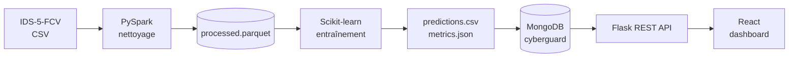

# CyberGuard

**Plateforme Big Data de détection des menaces de cybersécurité**


CyberGuard est un **prototype académique** qui exploite le dataset **IDS-5-FCV** pour construire une chaîne complète, reproductible et démontrable :

```
IDS-5-FCV  →  PySpark  →  Scikit-learn  →  MongoDB  →  Flask API  →  React
```

> **Périmètre.** Analyse *batch* d'un dataset public. CyberGuard n'est pas un système de surveillance réseau en production et ne déclenche aucune réponse automatique.

---

## Sommaire

1. [Fonctionnalités](#fonctionnalités)
2. [Architecture](#architecture)
3. [Dataset](#dataset)
4. [Structure du dépôt](#structure-du-dépôt)
5. [Prérequis](#prérequis)
6. [Installation et lancement](#installation-et-lancement)
7. [Modèle de données MongoDB](#modèle-de-données-mongodb)
8. [API REST](#api-rest)
9. [Workflow Git](#workflow-git)
10. [Limites et précautions](#limites-et-précautions)
11. [Équipe](#équipe)

---

## Fonctionnalités

| Page | Contenu |
|---|---|
| **Overview** | Volume analysé, alertes détectées, répartition normal/attaque, types d'attaques les plus fréquents |
| **Threats / Alerts** | Tableau des événements suspects : type d'attaque, classe prédite, score, date, filtres, pagination |
| **Analytics** | Distributions par classe et par type d'attaque, graphiques comparatifs |
| **Model Performance** | Accuracy, precision, recall, F1 par classe, macro-F1, matrice de confusion |
| **Methodology** | Dataset, pipeline, modèle, protocole de test, limites, date d'analyse |
| **API status** | État de Flask et de la connexion MongoDB |

---

## Architecture



| Couche | Technologie | Rôle |
|---|---|---|
| Source | IDS-5-FCV | Vérification de la provenance, de la licence et du schéma |
| Traitement | Python, Pandas, PySpark | Profilage, nettoyage, export Parquet |
| Machine Learning | Scikit-learn | Entraînement, prédiction, évaluation |
| Base de données | MongoDB + PyMongo | Prédictions, alertes, métriques, agrégats du dashboard |
| Backend | Flask + Flask-CORS | Accès MongoDB, endpoints JSON, validation, gestion d'erreurs |
| Frontend | React + Plotly ou Recharts | Pages, filtres, graphiques, tableaux |

**Principes de conception**

- React ne se connecte **jamais** directement à MongoDB : seul Flask détient l'URI.
- MongoDB stocke les **résultats** utiles au dashboard, pas le dataset brut. Les gros volumes tabulaires restent en Parquet.
- React n'a pas à recalculer les métriques : il affiche celles produites par le modèle.

---

## Dataset

**IDS-5-FCV** n'est pas un dataset unique mais une **collection** de datasets IDS (KDD Cup 99, NSL-KDD, UNSW-NB15, CIC-IDS2017, CIC-CSE-IDS2018, CIC-DDoS2019, etc.) pré-traités et partitionnés en validation croisée stratifiée à 5 plis.

| | |
|---|---|
| **Collection** | *Collection of Intrusion Detection Systems (IDS) Datasets "Preprocessed"* |
| **Auteurs** | J.M. Martínez-Ramírez, C.J. Carmona (Universidad de Jaén) |
| **Publication** | 05/11/2025 : <https://hdl.handle.net/10953/6318> |
| **Sous-ensemble utilisé** | **CIC-IDS2017, pli 2** (`fold_2_train.csv`, `fold_2_test.csv`) |
| **Dataset d'origine** | <https://www.unb.ca/cic/datasets/ids-2017.html> |
| **Licence** | CC BY-NC-ND selon le dépôt institutionnel, sauf indication contraire. **Les données ne sont jamais versionnées dans Git.** |

### Constats sur les fichiers

- **Pas d'en-tête** : 77 variables numériques nommées `f00`–`f76`, plus la colonne `label` (dernière colonne).
- **Données brutes** : les valeurs vont d'environ −2,6·10⁸ à 2,1·10⁹ (non normalisées, malgré la description de la collection).
- **Valeurs invalides** : infinis, `?` et valeurs mal formées dans quelques colonnes.
- **Doublons massifs** : 504 332 lignes dupliquées dans le train.
- **Fuite train/test** : 178 918 lignes du test (60 %) ont une copie exacte dans le train.
- **Bruit d'étiquetage** : 161 vecteurs de variables apparaissent avec plusieurs labels différents (conservés tels quels).

### Traitement PySpark

`src/processing/prepare_data.py` applique, dans cet ordre :

1. Lecture des CSV sans en-tête, nommage des colonnes, nettoyage des labels.
2. Suppression des lignes contenant des valeurs invalides (infinis, `?`, mal formées).
3. Dédoublonnage du train et du test.
4. Retrait du test de toute ligne déjà présente dans le train.
5. Génération d'un `record_id` stable (hash du contenu) et de `is_attack`.
6. Export en Parquet.

| | Train | Test |
|---|---:|---:|
| Brut | 1 187 138 | 296 786 |
| Sans valeurs invalides | 1 185 789 | 296 461 |
| **Final** | **682 562** | **108 641** |

**Schéma de `processed.parquet`** : `record_id`, `split` (`train`/`test`), `f00`–`f76`, `label`, `is_attack` (82 colonnes, 791 203 lignes).

| Classe | Train | Test |
|---|---:|---:|
| BENIGN | 527 121 | 83 167 |
| DoS Hulk | 81 960 | 13 556 |
| DDoS | 60 648 | 9 875 |
| DoS GoldenEye | 4 870 | 828 |
| DoS slowloris | 2 593 | 400 |
| DoS Slowhttptest | 2 511 | 396 |
| PortScan | 1 098 | 142 |
| Bot | 724 | 110 |
| Web Attack - Brute Force | 698 | 116 |
| Web Attack - XSS | 305 | 44 |
| Infiltration | 16 | 3 |
| Web Attack - Sql Injection | 12 | 2 |
| Heartbleed | 6 | 2 |

> **Déséquilibre.** BENIGN domine, et plusieurs classes comptent moins de 5 exemples de test. L'accuracy seule est trompeuse : publier precision, recall et F1 **par classe**, ainsi que le macro-F1, avec les effectifs.

---

## Structure du dépôt

```
cyberguard/
├── backend/
│   ├── app.py
│   ├── config.py
│   ├── db.py
│   ├── routes/                 # health, summary, metrics, predictions, alerts
│   ├── scripts/import_results.py
│   └── requirements.txt
├── frontend/
│   ├── src/components/
│   ├── src/pages/
│   ├── src/services/api.js
│   └── package.json
├── src/
│   ├── processing/
│   │   ├── profile_data.py     # profilage du dataset
│   │   └── prepare_data.py     # pipeline PySpark -> Parquet
│   └── detection/train.py      # entraînement et évaluation
├── docs/                       # fiche dataset, dictionnaire, rapports
├── data/                       # local, ignoré par Git
├── models/  outputs/           # locaux, ignorés par Git
├── .env.example
├── .gitignore
└── README.md
```

---

## Prérequis

| Outil | Version testée |
|---|---|
| Python | 3.11.9 |
| Java (JDK complet) | Temurin 21 |
| PySpark | 4.3.0 |
| pandas | 2.3.3 (PySpark ne supporte pas encore pleinement pandas ≥ 3) |
| pyarrow | 26.0.1 |
| MongoDB | Community ou Atlas — *version à renseigner* |
| Node.js | *version à renseigner* |

> **Windows et Java.** PySpark 4 exige un **JDK complet** (module `jdk.incubator.vector`). Un JRE allégé, comme celui embarqué par Eclipse, provoque l'erreur `Module jdk.incubator.vector not found`. Définir `JAVA_HOME` vers le JDK.

---

## Installation et lancement

Les commandes ci-dessous sont pour **Windows (cmd)**.

### 1. Cloner et créer l'environnement Python

```bat
git clone https://github.com/ayayoussfiii/CyberGuard.git
cd CyberGuard
python -m venv .venv
.venv\Scripts\activate
pip install -r docs\requirements_data.txt
```

### 2. Configurer l'environnement

```bat
copy .env.example .env
```

Renseigner `MONGO_URI` et `MONGO_DB_NAME` dans `.env`. **Ne jamais committer `.env`.**

### 3. Préparer les données

Télécharger l'archive `CIC_IDS2017.zip` depuis la collection IDS-5-FCV (lien dans la section [Dataset](#dataset)), extraire `fold_2_train.csv` et `fold_2_test.csv` dans `data\CIC_IDS2017\`, puis :

```bat
python src\processing\profile_data.py > docs\profil_dataset.txt
python src\processing\prepare_data.py > docs\prepare_report.txt
```

Le fichier produit est `data\processed.parquet`.

> **Windows et Parquet.** L'écriture Spark native échoue sans `winutils.exe` (`HADOOP_HOME` non défini). Le script contourne le problème : Spark traite les données, puis pandas/pyarrow écrit le Parquet.

### 4. Entraîner le modèle

```bat
python src\detection\train.py
```

Produit `predictions.csv`, `metrics.json` et le modèle sérialisé *(en cours de développement)*.

### 5. Lancer MongoDB, l'API puis le frontend

```bat
:: Terminal 1 : API Flask
pip install -r backend\requirements.txt
python backend\scripts\import_results.py
python backend\app.py

:: Terminal 2 : frontend React
cd frontend
npm install
npm run dev
```

Définir l'URL de l'API dans `frontend\.env` (par exemple `VITE_API_BASE_URL=http://localhost:5000`).

---

## Modèle de données MongoDB

Base : `cyberguard`. Index sur `record_id`, `created_at`, `predicted_label` et `severity`.

| Collection | Champs |
|---|---|
| `predictions` | `record_id`, `true_label`, `predicted_label`, `attack_type`, `score` (facultatif), `created_at` |
| `metrics` | `run_id`, `model_name`, `accuracy`, `precision`, `recall`, `f1`, `macro_f1`, `confusion_matrix`, `test_size`, `created_at` |
| `alerts` | `record_id`, `severity` (règle documentée), `attack_type`, `predicted_label`, `score`, `status`, `created_at` |

Le script d'import est **idempotent** : une ré-exécution ne crée pas de doublons (clé `record_id` stable).

---

## API REST

| Méthode | Endpoint | Description |
|---|---|---|
| GET | `/api/health` | Statut de Flask et de la connexion MongoDB |
| GET | `/api/summary` | Volumes, alertes, répartition normal/attaque |
| GET | `/api/metrics` | Métriques et matrice de confusion |
| GET | `/api/alerts` | Alertes, avec filtres et pagination |
| GET | `/api/predictions` | Prédictions, avec filtres |
| GET | `/api/distribution` | Agrégations par classe / type d'attaque |

Tous les endpoints valident leurs paramètres, **limitent le nombre de résultats**, renvoient du JSON et gèrent l'indisponibilité de MongoDB.

---

## Workflow Git

- `main` : version stable. `develop` : intégration.
- Une branche par membre : `feature/aya-data-pipeline`, `feature/meriem-ml`, `feature/zineb-react-flask-mongodb`.
- Commits fréquents, puis **Pull Request vers `develop`**, relue par une autre membre avant fusion.
- Prévenir l'équipe avant toute modification d'un contrat de données ou d'un endpoint.

**Exclus de Git** : `.venv/`, `node_modules/`, `__pycache__/`, `.env`, `data/`, `*.parquet`, `*.csv`, `outputs/`, `models/`.

---

## Limites et précautions

- Prototype académique : un seul pli (le pli 2) de CIC-IDS2017 est exploité, les autres plis de l'archive téléchargée étant corrompus.
- Résultats valables pour ce dataset uniquement : pas de garantie de généralisation à du trafic réel.
- Le nettoyage change la distribution d'origine (le test passe de 20 % à environ 14 % du total après retrait des doublons et de la fuite).
- Les classes les plus rares (Heartbleed, Infiltration, SQL Injection) ont très peu d'exemples de test : leurs scores sont statistiquement instables.
- Fuite de données : ajuster toute transformation apprise (mise à l'échelle, sélection de variables) sur le **train uniquement**.
- CORS : configuré pour l'origine React en développement, à restreindre en déploiement.

---


## Références

- Martínez-Ramírez, J.M. et Carmona, C.J., *Collection of Intrusion Detection Systems (IDS) Datasets "Preprocessed"*, Universidad de Jaén, 2025. <https://hdl.handle.net/10953/6318>
- Canadian Institute for Cybersecurity, *CIC-IDS2017*. <https://www.unb.ca/cic/datasets/ids-2017.html>

## Licence du code

*À définir par l'équipe.* Les données restent soumises à la licence de leur source.
